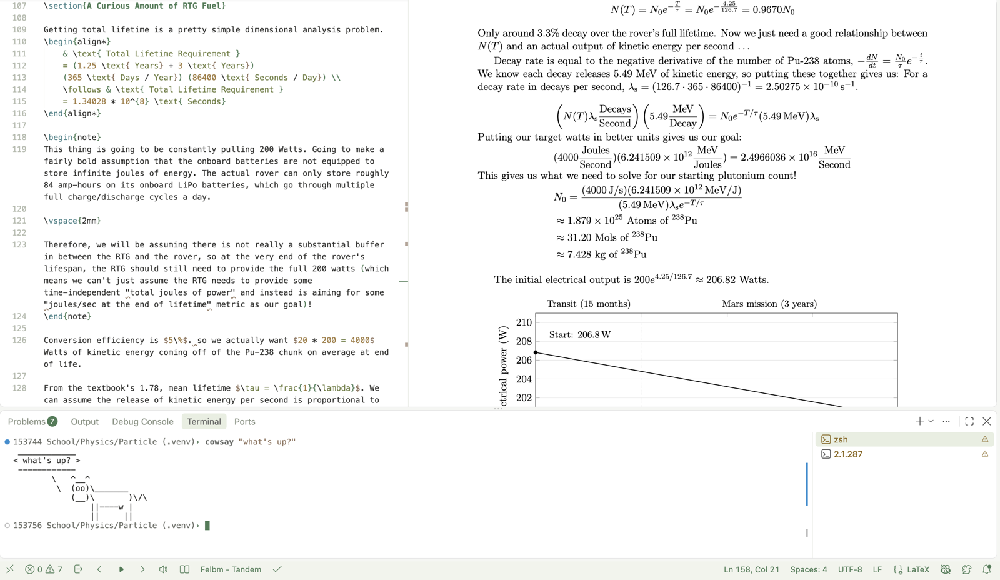

# Clay's VS Code Themes

Light, earthy themes for VS Code.

## Vancouver

A calm light theme. White backdrop, soft charcoal text, forest green, bark brown and olive. Teal is the one cool accent.

| Token | Color |
|---|---|
| Keywords | forest green `#4a7c55` |
| Strings | bark brown `#8c6f58` |
| Types, decorators | olive `#6e7d3f` |
| Functions | teal `#3f7f86` |
| Numbers | ochre `#a0793a` |
| Comments | gray-green `#858f80` |
| Text | `#2b2b29` |

Run `Preferences: Color Theme` and pick **Vancouver**.

Syntax colors are tuned for Python and LaTeX. Other languages use the same scopes and may need small tweaks.
